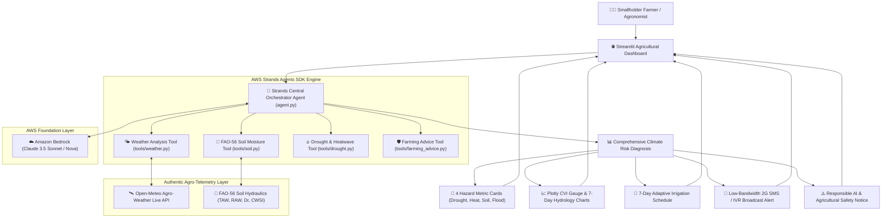

# 🌾 FarmGuard-AI-Strands-Agent
### Multi-Agent Climate Resilience & Drought Intelligence for Smallholder Farmers
*Built with the Official AWS Strands Agents SDK & Amazon Bedrock*

[](https://www.python.org/)
[](https://github.com/aws)
[](https://aws.amazon.com/bedrock/)
[](https://streamlit.io/)
[-brightgreen.svg)](tests/)
[](LICENSE)
[](farmguard/data/telugu_translations.py)

---

## 📌 1. Executive Summary & Problem Statement

Over **500 million smallholder farming families** worldwide produce more than one-third of the global food supply. However, they operate on the frontlines of the climate crisis without access to real-time agronomists or expensive IoT soil moisture sensors. Unpredictable flash droughts, intense heatwaves during crop anthesis (flowering), and erratic monsoon dry spells lead to devastating, preventable yield losses.

**FarmGuard AI** bridges this critical gap. It is an autonomous climate resilience assistant built on the **official AWS Strands Agents SDK** (`strands-agents`) and **Amazon Bedrock**. By fusing real-time satellite agro-meteorology with verified **FAO-56 dual crop water balance physics**, FarmGuard AI predicts localized climate hazards and delivers actionable, low-cost adaptation strategies in **English** and **Telugu (తెలుగు)**.

---

## 🏗️ 2. System Architecture & Strands Agent Workflow



### The Strands Tool Execution Flow:
1. **Weather Analysis Tool (`get_weather_forecast`)**: Queries Open-Meteo for 7-day temperature trends, solar radiation, rainfall, and FAO-56 reference evapotranspiration ($ET_0$).
2. **Soil Hydrology Tool (`analyze_soil_moisture`)**: Applies FAO-56 dual crop coefficient formulas to calculate Total Available Water ($TAW$), Readily Available Water ($RAW$), rootzone depletion ($D_r$), and Crop Water Stress Index ($CWSI$).
3. **Drought Risk Tool (`calculate_drought_risk`)**: Calculates the net water deficit ($P - ET_0$), consecutive dry day streaks, heatwave degree anomalies above crop-specific critical thresholds ($T_{crit}$), and the Composite Vulnerability Index ($CVI$).
4. **Farming Advice Tool (`get_farming_recommendations`)**: Formulates prioritized 24-48h emergency actions, a 7-day adaptive irrigation schedule, and a 2G SMS alert formatted in English or Telugu.

---

## 🔬 3. Scientific Methodology & FAO-56 Formulations

FarmGuard AI calculates crop water dynamics using the **UN FAO Irrigation and Drainage Paper No. 56**:

* **Total Available Water (TAW)**:
  $$TAW = 1000 \times (\theta_{FC} - \theta_{PWP}) \times Z_r \quad (\text{mm})$$
  *(where $\theta_{FC}$ is field capacity, $\theta_{PWP}$ is permanent wilting point, and $Z_r$ is crop rooting depth).*

* **Readily Available Water (RAW)**:
  $$RAW = p \times TAW \quad (\text{mm})$$
  *(where $p$ is the crop-specific average soil water depletion fraction).*

* **Transpiration Reduction Factor ($K_s$) & Water Stress ($CWSI$)**:
  $$K_s = \frac{TAW - D_r}{(1 - p) \times TAW} \quad (\text{for } D_r > RAW)$$
  $$CWSI = 1 - K_s \quad (0.0 = \text{no stress}, 1.0 = \text{extreme permanent wilting})$$

* **Composite Vulnerability Index (CVI)**:
  $$CVI = 0.40 \times \text{Drought} + 0.35 \times \text{Heatwave} + 0.25 \times \text{Flood}$$

---

## ⚡ 4. Quickstart & Installation

### Prerequisites
- Python **3.10 to 3.13**
- Git

### Step 1: Clone the Repository
```bash
git clone https://github.com/anusha975/FarmGuard-AI-Strands-Agent.git
cd FarmGuard-AI-Strands-Agent
```

### Step 2: Set Up Virtual Environment

**On Windows (PowerShell):**
```powershell
python -m venv .venv
.\.venv\Scripts\activate
```

**On Linux / macOS (Bash):**
```bash
python3 -m venv .venv
source .venv/bin/activate
```

### Step 3: Install Dependencies
```bash
pip install -r requirements.txt
```

---

## ☁️ 5. AWS Bedrock Configuration (Optional)

FarmGuard AI runs in **high-reliability Agronomic Science Fallback Mode** out of the box without requiring AWS credentials. To enable Amazon Bedrock Claude 3.5 Sonnet / Nova LLM reasoning:

1. **Copy the configuration template:**
   ```powershell
   Copy-Item .env.example .env    # Windows PowerShell
   cp .env.example .env          # Linux/macOS
   ```
2. **Fill in your AWS credentials in `.env`:**
   ```ini
   AWS_REGION=us-east-1
   AWS_DEFAULT_REGION=us-east-1
   AWS_ACCESS_KEY_ID=your_access_key_here
   AWS_SECRET_ACCESS_KEY=your_secret_access_key_here
   BEDROCK_MODEL_ID=anthropic.claude-3-5-sonnet-20240620-v1:0
   FARMGARD_MODE=live
   ```

### Least-Privilege IAM Policy:
Attach this policy to your IAM user or role:
```json
{
  "Version": "2012-10-17",
  "Statement": [
    {
      "Sid": "FarmGuardBedrockModelAccess",
      "Effect": "Allow",
      "Action": [
        "bedrock:InvokeModel",
        "bedrock:InvokeModelWithResponseStream"
      ],
      "Resource": [
        "arn:aws:bedrock:*::foundation-model/anthropic.claude-3-5-sonnet-*",
        "arn:aws:bedrock:*::foundation-model/anthropic.claude-3-haiku-*",
        "arn:aws:bedrock:*::foundation-model/amazon.nova-*"
      ]
    },
    {
      "Sid": "FarmGuardBedrockDiscovery",
      "Effect": "Allow",
      "Action": [
        "bedrock:ListFoundationModels",
        "bedrock:GetFoundationModel"
      ],
      "Resource": "*"
    }
  ]
}
```

*For complete setup and cost details, see [docs/AWS_BEDROCK_SETUP.md](docs/AWS_BEDROCK_SETUP.md).*

---

## 💻 6. Running the Application

### Option A: Launch Interactive Streamlit Dashboard
```bash
streamlit run app.py
```
Open your browser at **`http://localhost:8501`**.

### Option B: Run Python Agent Directly via CLI
```bash
python agent.py
```

---

## 📊 7. Example Input & Output

### Example Input Profile:
```python
profile = {
    "farmer_name": "రాము నాయుడు (Ramu Naidu)",
    "location_name": "Anantapur, Andhra Pradesh",
    "latitude": 14.68,
    "longitude": 77.60,
    "crop_name": "Groundnut (Peanut)",
    "growth_stage": "Flowering/Anthesis",
    "soil_type": "Sandy Loam",
    "irrigation_access": "Rainfed Only",
    "language": "te",
    "demo_mode": False
}
```

### Example Structured Output (Bilingual Telugu / English):
```json
{
  "status": "success",
  "data_source": "🟢 LIVE DATA (Open-Meteo Agro-Weather API)",
  "overall_status": "అధిక ప్రమాదం (High Warning)",
  "composite_vulnerability_index": 54.5,
  "soil": {
    "crop_water_stress_index_cwsi": 0.58,
    "total_available_water_taw_mm": 100.0,
    "readily_available_water_raw_mm": 50.0,
    "rootzone_depletion_mm": 68.2,
    "soil_risk_level": "Moderate"
  },
  "drought": {
    "drought_risk_level": "High",
    "heatwave_risk_level": "High",
    "drought_drivers": [
      "Severe atmospheric deficit (Rainfall 0.0mm vs ET0 32.4mm = -32.4mm)",
      "Prolonged dry streak of 6 consecutive days",
      "Extreme heat 37.8°C exceeds Groundnut critical limit (36.0°C)"
    ]
  },
  "recommendations": {
    "immediate_actions": [
      "🔥 అధిక ఉష్ణోగ్రత హెచ్చరిక: ఎండ తీవ్రత వల్ల తేమ ఆవిరి కాకుండా మరియు పంట మాడిపోకుండా ఉండటానికి సాయంత్రం లేదా రాత్రి వేళల్లో మాత్రమే తడులు ఇవ్వండి.",
      "🌸 పూత రక్షణ: పూత రాలిపోకుండా ఉండేందుకు వేర్ల వద్ద తేమను కాపాడండి.",
      "🌾 ఆచ్ఛాదన (Mulching): నేలలో తేమ ఆవిరి కాకుండా పంట వ్యర్థాలు లేదా ఎండుగడ్డితో నేలను కప్పండి."
    ],
    "sms_dispatch": "🌾 ఫామ్‌గార్డ్ అలర్ట్ | పంట: వేరుశనగ | ముప్పు: అధిక ప్రమాదం (54.5%) | చర్య: ఎండ తీవ్రత వల్ల సాయంత్రం తడి ఇవ్వండి. పూత రాలకుండా నేలపై ఆచ్ఛాదన (Mulching) చేయండి. - ఫామ్‌గార్డ్ ఏఐ"
  }
}
```

---

## 🧪 8. Automated Test Suite

FarmGuard AI includes a **62-test automated suite** covering tool execution, boundary conditions, input validation, network faults, and AWS Bedrock degradation:

```bash
python -m unittest discover -s tests -p "test_*.py"
```

**Test Execution Result:**
```text
Ran 62 tests in 30.109s

OK
```

### Test Coverage Highlights:
- **`tests/test_qa_comprehensive.py`** (42 tests): All 13 core requirements, FAO-56 dual crop physics, extreme wilting conditions, API 500 errors, network timeouts, Telugu Unicode integrity, and UI visualization fixtures.
- **`tests/test_aws_bedrock.py`** (6 tests): Least-privilege IAM policies, Bedrock access degradation, credential protection, and model catalog.
- **`tests/test_backend_strands.py`** (6 tests): End-to-end Strands orchestrator agent pipelines.
- **`tests/test_tools.py`** (4 tests): Individual tool logic and data contracts.
- **`tests/test_orchestrator.py`** (3 tests): Multilingual orchestrator workflows.
- **`tests/test_agents.py`** (1 test): Legacy multi-agent collaboration trace.

---

## ⚠️ 9. Limitations & Responsible AI Disclaimer

### Current Limitations:
1. **Satellite Spatial Resolution**: Open-Meteo forecasts operate on a ~1-10 km grid resolution. Hyper-local microclimates (steep valleys, riverbanks) may experience localized variations.
2. **Soil Depth Homogeneity**: FAO-56 calculations assume a uniform soil profile within the effective rootzone depth ($Z_r$).
3. **No Substitute for Certified Extension**: Automated advisories should complement, not replace, certified agricultural advice from local agricultural universities, Krishi Vigyan Kendras (KVK), or Rythu Bharosa Kendras (RBK).

### Responsible AI & Agricultural Safety Notice:
> [!IMPORTANT]
> **FarmGuard AI is an advisory decision-support assistant**. Smallholder farmers and extension workers must independently verify automated recommendations with local agricultural officers before making major financial, planting, or agrochemical commitments.

---

## 🔮 10. Future Roadmap

- [ ] **LoRaWAN IoT Sensor Ingestion**: Real-time wireless soil probe telemetry via AWS IoT Core.
- [ ] **Hyper-Local Voice IVR (Interactive Voice Response)**: AWS Polly integration for dial-in voice alerts in local Telugu dialects.
- [ ] **Drone Multispectral Imagery**: Crop canopy stress detection fusing NDVI with Bedrock multimodal analysis.
- [ ] **Micro-Insurance Integration**: Parametric drought index triggering automated blockchain smart-contract insurance payouts.

---

## 📄 11. License & Authors

Distributed under the **MIT License**. See [`LICENSE`](LICENSE) for details.

Developed for the **AWS AI Agents Hackathon** by **Anusha** ([@anusha975](https://github.com/anusha975)) using the **Official AWS Strands Agents SDK** and **Amazon Bedrock**.
