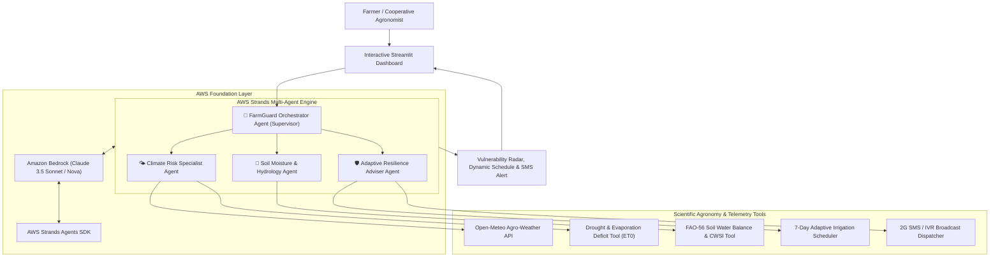

# 🌾 FarmGuard AI
### Multi-Agent Climate Resilience Assistant for Smallholder Farmers
*Built for the AWS AI Hackathon with the Official AWS Strands Agents SDK & Amazon Bedrock*

[](https://www.python.org/)
[](https://github.com/aws)
[](https://aws.amazon.com/bedrock/)
[](https://streamlit.io/)
[](LICENSE)

---

## 📌 1. Executive Summary & Problem Statement

Over **500 million smallholder farming families** worldwide produce more than one-third of the global food supply. However, they operate on the frontlines of the climate crisis without access to real-time agronomists or expensive IoT soil sensors. Unpredictable flash droughts, intense heatwaves during crop anthesis (flowering), and erratic monsoon downpours lead to devastating, preventable yield losses.

**FarmGuard AI** bridges this gap. It is an autonomous, multi-agent climate intelligence assistant that fuses real-time agro-meteorological telemetry with FAO-56 crop hydrology physics to predict localized climate risks and deliver actionable, low-cost adaptation strategies.

---

## 🏗️ 2. System Architecture & Multi-Agent Design

FarmGuard AI is built using the **Official AWS Strands Agents SDK** connecting specialized reasoning agents powered by **Amazon Bedrock** (Anthropic Claude 3.5 Sonnet / Amazon Nova):



### The Multi-Agent Collaboration Loop:
1. **FarmGuard Orchestrator (Supervisor)**: Ingests the farmer's profile (crop type, growth stage, soil texture, coordinates, irrigation access), manages task delegation, calculates the Composite Vulnerability Index, and aggregates findings.
2. **Climate Risk Specialist Agent**: Monitors 7-day temperature trends against crop-specific thermal limits ($T_{crit}$), detects heatwaves, computes vapor pressure deficit, and tracks dry spell streaks.
3. **Soil Moisture & Agronomy Agent**: Applies the **FAO-56 dual crop coefficient methodology** to compute Total Available Water ($TAW$), Readily Available Water ($RAW$), rootzone depletion ($D_r$), and the Crop Water Stress Index ($CWSI$).
4. **Adaptive Resilience Adviser Agent**: Formulates high-impact, low-cost interventions (mulching, evening deficit irrigation, shade netting, rainwater harvesting) and day-by-day water application schedules.

---

## 🔬 3. Scientific Methodology & Formulations

FarmGuard AI is grounded in verified agricultural physics:

* **Total Available Water (TAW)**:
  $$TAW = 1000 \times (\theta_{FC} - \theta_{PWP}) \times Z_r$$
  where $\theta_{FC}$ is field capacity, $\theta_{PWP}$ is permanent wilting point, and $Z_r$ is rooting depth.

* **Readily Available Water (RAW)**:
  $$RAW = p \times TAW$$
  where $p$ is the crop-specific soil water depletion fraction.

* **Transpiration Reduction Factor ($K_s$) & Water Stress ($CWSI$)**:
  $$K_s = \frac{TAW - D_r}{(1 - p) \times TAW} \quad (\text{for } D_r > RAW)$$
  $$CWSI = 1 - K_s$$

* **Composite Vulnerability Index (CVI)**:
  $$CVI = 0.35 \times \text{Drought} + 0.30 \times \text{Soil Moisture} + 0.25 \times \text{Heatwave} + 0.10 \times \text{Flood}$$

---

## 🚀 4. Quickstart & Installation

### Prerequisites
* Windows, Linux, or macOS
* Python 3.10 to 3.13
* Git

### Step 1: Clone the Repository
```bash
git clone https://github.com/your-username/FarmGuard-AI.git
cd "FarmGuard AI"
```

### Step 2: Set Up Virtual Environment
```bash
python -m venv .venv
# On Windows:
.\.venv\Scripts\activate
# On Linux/macOS:
source .venv/bin/activate
```

### Step 3: Install Dependencies
```bash
pip install -r requirements.txt
# Or use ultra-fast uv:
uv pip install -r requirements.txt
```

### Step 4: Configure AWS Credentials (Optional)
Copy `.env.example` to `.env`:
```bash
cp .env.example .env
```
Add your AWS Bedrock credentials:
```ini
AWS_REGION=us-east-1
AWS_ACCESS_KEY_ID=your_access_key
AWS_SECRET_ACCESS_KEY=your_secret_key
BEDROCK_MODEL_ID=anthropic.claude-3-5-sonnet-20240620-v1:0
FARMGARD_MODE=live
```
> **Note:** If no credentials are provided, FarmGuard AI runs in **Resilient Simulation Mode**, providing offline agro-climatic multi-agent reasoning for local demonstrations.

---

## 🧪 5. Running Tests

Run the automated test suite verifying both tools and multi-agent workflows:
```bash
python -m unittest discover tests
```

Output:
```text
Ran 5 tests in 2.06s
OK
```

---

## 💻 6. Running the Streamlit Dashboard

Launch the interactive web application:
```bash
streamlit run app.py
```
Open your browser at `http://localhost:8501`.

### Key Features of the UI:
1. **Regional Benchmarks**: Instant presets for vulnerable smallholder zones (Vidarbha, Dodoma, Rift Valley, Sahelian Drylands, etc.).
2. **Interactive Risk Gauges**: Composite Vulnerability Index (CVI) gauge with dynamic alert color bands.
3. **Interactive Agro-Meteorological Curves**: Plotly charts visualizing 7-day temperature vs. crop thermal threshold and precipitation vs. evapotranspiration demand ($ET_0$).
4. **Transparent Multi-Agent Reasoning Trace**: Inspect the exact chain-of-thought generated by each specialist agent.
5. **Low-Bandwidth 2G SMS / IVR Audio Dispatch**: Formatted text ready for SMS gateways or radio broadcasts.

---

## 🌍 7. Real-World Impact & Alignment

| Metric | Target Impact |
|---|---|
| **Water Conservation** | 25% – 35% reduction in irrigation water usage via deficit scheduling |
| **Yield Preservation** | Prevention of up to 40% thermal abortion losses through timely canopy cooling |
| **Accessibility** | 100% zero-sensor barrier; works via standard GPS coordinates and SMS |
| **UN SDGs** | Aligns with **SDG 2** (Zero Hunger) and **SDG 13** (Climate Action) |

---

## 📄 8. License
Distributed under the MIT License. See `LICENSE` for details.
