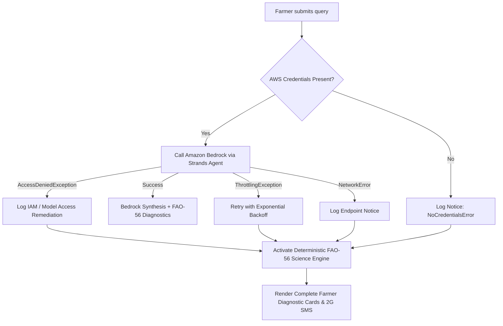

# ☁️ Amazon Bedrock & AWS Integration Guide for FarmGuard AI

This document provides a comprehensive guide for configuring, testing, and running **FarmGuard AI** with **Amazon Bedrock** and the **official AWS Strands Agents SDK**.

---

## 📋 Table of Contents
1. [Overview & Strands Agents Integration](#1-overview--strands-agents-integration)
2. [Supported Foundation Models & Regional Availability](#2-supported-foundation-models--regional-availability)
3. [Required IAM Permissions & Security Policy](#3-required-iam-permissions--security-policy)
4. [Step-by-Step AWS Setup Guide](#4-step-by-step-aws-setup-guide)
   - [Step 4.1: Request Bedrock Model Access](#step-41-request-bedrock-model-access)
   - [Step 4.2: Create Least-Privilege IAM User / Role](#step-42-create-least-privilege-iam-user--role)
   - [Step 4.3: Configure Credentials Locally](#step-43-configure-credentials-locally)
5. [Cost Analysis & Token Pricing Estimator](#5-cost-analysis--token-pricing-estimator)
6. [Error Handling & Failure Recovery](#6-error-handling--failure-recovery)
7. [Verification & Automated Testing](#7-verification--automated-testing)

---

## 1. Overview & Strands Agents Integration

FarmGuard AI uses the **official AWS Strands Agents SDK** (`strands-agents`) to orchestrate multi-tool agronomic reasoning. In the backend (`agent.py`), the central orchestrator agent is initialized with `strands.models.bedrock.BedrockModel`:

```python
from strands import Agent
from strands.models.bedrock import BedrockModel

# Initialize official Bedrock Model Provider
bedrock_provider = BedrockModel(
    region_name=os.getenv("AWS_REGION", "us-east-1"),
    model_id=os.getenv("BEDROCK_MODEL_ID", "anthropic.claude-3-5-sonnet-20240620-v1:0")
)

# Connect Strands Agent to Bedrock and register custom agronomic tools
agent = Agent(
    model=bedrock_provider,
    tools=[
        get_weather_forecast,
        analyze_soil_moisture,
        calculate_drought_risk,
        get_farming_recommendations,
    ],
    system_prompt=SYSTEM_PROMPT
)
```

---

## 2. Supported Foundation Models & Regional Availability

FarmGuard AI supports four optimized foundation models in Amazon Bedrock:

| Model Provider | Foundation Model ID | Best Suited For | Input / 1k Tokens | Output / 1k Tokens |
| :--- | :--- | :--- | :--- | :--- |
| **Anthropic** | `anthropic.claude-3-5-sonnet-20240620-v1:0` | Complex multi-hazard agro-climatic synthesis (Default) | \$0.0030 | \$0.0150 |
| **Anthropic** | `anthropic.claude-3-haiku-20240307-v1:0` | Ultra-low latency 2G SMS / audio IVR alerts | \$0.00025 | \$0.00125 |
| **Amazon** | `amazon.nova-pro-v1:0` | High-accuracy agronomic planning | \$0.0008 | \$0.0032 |
| **Amazon** | `amazon.nova-lite-v1:0` | Low-cost multilingual Telugu / English translation | \$0.00006 | \$0.00024 |

> [!NOTE]
> **Recommended Regions**: `us-east-1` (N. Virginia), `us-west-2` (Oregon), or `ap-south-1` (Mumbai). Ensure your chosen region supports both Bedrock and your requested Foundation Model.

---

## 3. Required IAM Permissions & Security Policy

To adhere to the principle of **least privilege**, do not attach administrative privileges (`AdministratorAccess`). Instead, use the following dedicated IAM policy:

### IAM Policy JSON: `FarmGuardBedrockLeastPrivilegePolicy`

```json
{
  "Version": "2012-10-17",
  "Statement": [
    {
      "Sid": "BedrockModelInvocation",
      "Effect": "Allow",
      "Action": [
        "bedrock:InvokeModel",
        "bedrock:InvokeModelWithResponseStream"
      ],
      "Resource": [
        "arn:aws:bedrock:*::foundation-model/anthropic.claude-3-5-sonnet-*",
        "arn:aws:bedrock:*::foundation-model/anthropic.claude-3-haiku-*",
        "arn:aws:bedrock:*::foundation-model/amazon.nova-*"
      ]
    },
    {
      "Sid": "BedrockModelDiscovery",
      "Effect": "Allow",
      "Action": [
        "bedrock:ListFoundationModels",
        "bedrock:GetFoundationModel"
      ],
      "Resource": "*"
    }
  ]
}
```

### Why each permission is required:
1. `bedrock:InvokeModel`: Grants the Strands Agent permission to send prompts and tool payloads to Claude 3.5 Sonnet / Nova and receive inference results.
2. `bedrock:InvokeModelWithResponseStream`: Allows streaming responses for low-latency token streaming to the Streamlit UI.
3. `bedrock:ListFoundationModels`: Used during health-check probes to verify model availability in the configured AWS region.

---

## 4. Step-by-Step AWS Setup Guide

### Step 4.1: Request Bedrock Model Access
1. Sign in to the **AWS Management Console**.
2. Navigate to **Amazon Bedrock** (ensure region is set to `us-east-1` or `us-west-2`).
3. In the left navigation pane, scroll to the bottom and select **Model access**.
4. Click the orange **"Modify model access"** button (top right).
5. Check the box for:
   - **Anthropic** -> `Claude 3.5 Sonnet` and `Claude 3 Haiku`.
   - **Amazon** -> `Nova Pro` and `Nova Lite`.
6. Fill in the short use-case questionnaire if prompted for Anthropic models (e.g., *"Agricultural climate resilience assistant for smallholder farmers"*).
7. Submit the request. Access is typically granted within 1–2 minutes.

---

### Step 4.2: Create Least-Privilege IAM User / Role
1. Open the **AWS IAM Console** (`https://console.aws.amazon.com/iam`).
2. Go to **Policies** -> **Create policy**.
3. Select the **JSON** tab, paste the `FarmGuardBedrockLeastPrivilegePolicy` document from Section 3 above, and name it `FarmGuardBedrockPolicy`.
4. Go to **Users** -> **Create user** (e.g., `farmguard-agent-user`).
5. In **Set permissions**, select **Attach policies directly**, search for `FarmGuardBedrockPolicy`, and select it.
6. Complete user creation, then navigate to **Security credentials** -> **Create access key** -> Select **Application running outside AWS**.
7. Securely save the `Access Key ID` and `Secret Access Key`.

---

### Step 4.3: Configure Credentials Locally

> [!CAUTION]
> **Never commit your credentials into source code, git commits, or GitHub.**

FarmGuard AI supports two safe methods to pass credentials:

#### Option A: Local `.env` file (Recommended for development)
1. Copy `.env.example` to `.env`:
   ```powershell
   Copy-Item .env.example .env
   ```
2. Open `.env` and paste your credentials:
   ```bash
   AWS_REGION=us-east-1
   AWS_DEFAULT_REGION=us-east-1
   AWS_ACCESS_KEY_ID=AKIAEXAMPLEKEY12345
   AWS_SECRET_ACCESS_KEY=wJalrXUtnFEMI/K7MDENG/bPxRfiCYEXAMPLEKEY
   BEDROCK_MODEL_ID=anthropic.claude-3-5-sonnet-20240620-v1:0
   FARMGARD_MODE=live
   ```
3. `.env` is already included in `.gitignore` and will never be tracked by git.

#### Option B: AWS CLI Named Profile or `~/.aws/credentials`
If you have the AWS CLI installed:
```bash
aws configure --profile farmguard
```
Then set in `.env`:
```bash
AWS_PROFILE=farmguard
AWS_REGION=us-east-1
```

---

## 5. Cost Analysis & Token Pricing Estimator

FarmGuard AI is engineered to be **extremely cost-effective** for smallholder farming communities and rural NGOs.

### Token Consumption Breakdown per Farmer Assessment:
- **Input Prompt (Farmer coordinates, crop profile, 7-day weather telemetry, soil water balance)**: ~1,100 – 1,400 tokens.
- **Output Completion (Hazard synthesis, immediate actions, 7-day schedule, 2G SMS alert)**: ~350 – 500 tokens.
- **Total Tokens per Assessment**: ~1,500 – 1,900 tokens.

### Cost Comparison per 1,000 Farmer Assessments:

| Model | Cost per 1,000 Input Tokens | Cost per 1,000 Output Tokens | Single Assessment Cost | Cost for 1,000 Full Assessments |
| :--- | :--- | :--- | :--- | :--- |
| **Claude 3.5 Sonnet** | \$0.00300 | \$0.01500 | **\$0.010** (~1.0 ¢) | **\$10.05** |
| **Claude 3 Haiku** | \$0.00025 | \$0.00125 | **\$0.0008** (~0.08 ¢) | **\$0.85** |
| **Amazon Nova Pro** | \$0.00080 | \$0.00320 | **\$0.0024** (~0.24 ¢) | **\$2.40** |
| **Amazon Nova Lite** | \$0.00006 | \$0.00024 | **\$0.00018** (~0.018 ¢) | **\$0.18** |

### Key Cost Protections:
- **No Upfront Fee**: Amazon Bedrock is 100% pay-as-you-go. You are billed only for the tokens consumed.
- **Zero Idle Costs**: When no farmer submits a query, operational cost is **\$0.00/hour**.
- **Free Weather Data**: Real-time agro-meteorological data is fetched from the Open-Meteo API without any API keys or subscription fees.

---

## 6. Error Handling & Failure Recovery

FarmGuard AI implements resilient multi-tier error handling (`farmguard/aws_bedrock.py` and `agent.py`) so an AWS network or credential issue never crashes the app or leaves the farmer stranded:



### Common AWS Error Codes and Auto-Remediation:
1. **`NoCredentialsError`**:
   - *Cause*: `.env` file is missing or AWS environment variables are unset.
   - *Behavior*: System logs an info warning and falls back to deterministic agronomic formulas; UI displays clear configuration instructions in the sidebar.
2. **`AccessDeniedException`**:
   - *Cause*: IAM user lacks `bedrock:InvokeModel` or model access was not requested in Bedrock console.
   - *Behavior*: UI alerts the administrator to visit Amazon Bedrock -> Model access to activate Claude models.
3. **`ValidationException`**:
   - *Cause*: Model ID is not supported in the specified AWS region.
   - *Behavior*: Displays suggested fallback region (e.g., `us-east-1`).

---

## 7. Verification & Automated Testing

You can verify the AWS integration and health check using the built-in CLI inspection:

### Run Safe AWS Health Check (Never displays secrets):
```powershell
.\.venv\Scripts\python.exe -c "from farmguard.aws_bedrock import check_bedrock_access; print(check_bedrock_access())"
```

### Run Full Test Suite:
```powershell
.\.venv\Scripts\python.exe -m unittest discover tests
```

### Run FarmGuard AI Dashboard:
```powershell
.\.venv\Scripts\streamlit.exe run app.py
```
