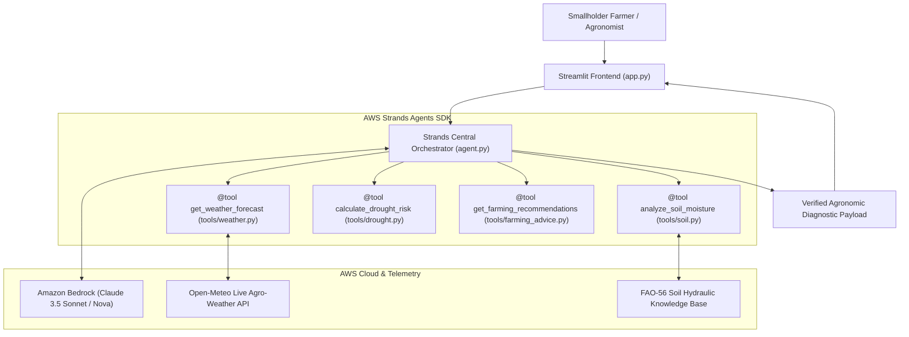

# 🌾 FarmGuard AI: Building a Climate Resilience Agent for Smallholder Farmers Using Strands Agents SDK

*By Anusha ([@anusha975](https://github.com/anusha975)) | AWS AI Agents Hackathon Project*

---

## 1. Introduction

Smallholder farmers stand at the epicenter of global food security and climate change. Over 500 million smallholder families produce more than a third of the world's food supply, yet they remain the most vulnerable to climate-induced volatility. A sudden five-day heatwave or an unseasonal monsoon dry spell during crop flowering can decimate an entire season's harvest, pushing vulnerable farming households into severe financial distress.

While enterprise commercial farms utilize expensive IoT soil moisture probes, drone multispectral imagery, and proprietary agro-climatic consultants, smallholder farmers often rely on generational intuition or generic regional weather forecasts that lack plot-level agronomic context.

**FarmGuard AI** was built to change this paradigm. Developed for the AWS AI Agents Hackathon using the **official AWS Strands Agents SDK** (`strands-agents`) and **Amazon Bedrock**, FarmGuard AI is an autonomous, multi-tool climate resilience assistant. It fuses real-time agro-meteorological telemetry with verified **FAO-56 dual crop coefficient hydrology** to assess localized drought, heatwave, and soil moisture risks, delivering actionable adaptation directives in **English** and **Telugu (తెలుగు)**.

---

## 2. The Social Problem

Rainfed and semi-arid dryland farming across vulnerable regions—such as Rayalaseema in Andhra Pradesh, Mahabubnagar in Telangana, Vidarbha in Maharashtra, and the African Rift Valley—faces three compounding structural crises:

1. **The Anthesis Vulnerability Window**: Crops such as groundnut, chickpea, sorghum, and maize have narrow thermal and moisture tolerances during phenological stages like flowering (anthesis) and grain filling. Temperatures exceeding critical physiological limits ($T_{crit}$, often 35–38°C) cause pollen sterility and blossom drop within 48 to 72 hours if unattended.
2. **The Sensor Cost Barrier**: Commercial digital agriculture tools require dedicated in-situ hardware. Capacitive soil moisture probes, solar data loggers, and cellular gateways cost anywhere from \$300 to \$1,500 per installation—an impossible capital expenditure for smallholders earning modest annual household incomes.
3. **The Advice Lag & Language Chasm**: Government agricultural extension officers serve favorable farmer-to-officer ratios that can exceed 1,000:1. When an extreme weather event strikes, advisory dissemination is often too slow to enable preventative intervention. Furthermore, advisories are frequently published in complex administrative jargon rather than actionable regional dialects delivered via low-bandwidth channels.

---

## 3. Target Population

FarmGuard AI is engineered specifically for:
- **Smallholder Farmers**: Managing 0.5 to 2.5 hectares of rainfed or borewell-dependent land cultivating staple and commercial dryland crops (groundnut, maize, sorghum, chickpea, cotton, tomato).
- **Farmer Producer Organizations (FPOs) & Rural Cooperatives**: Village-level aggregators needing batch climate assessments to coordinate community water-sharing, protective mulching, or localized shade netting.
- **Agricultural Extension Workers & Krishi Vigyan Kendras (KVKs)**: Field officers seeking rapid, scientifically grounded decision-support tools during farm visits.
- **Linguistic & Technological Demographic**: Smallholders communicating predominantly in regional vernaculars (such as Telugu) who rely on 2G feature phones or low-cost Android smartphones with limited cellular data bandwidth.

---

## 4. Proposed Solution

FarmGuard AI provides a zero-sensor, physics-grounded agricultural climate resilience system. By taking as little as a farmer's location coordinates and crop profile, the system:

- **Ingests Real-Time Agro-Telemetry**: Automatically retrieves 7-day meteorological forecasts, solar radiation, and reference evapotranspiration ($ET_0$) via open agro-meteorological APIs without inventing data.
- **Applies Scientific FAO-56 Soil Hydrology**: Computes Total Available Water ($TAW$), Readily Available Water ($RAW$), rootzone depletion ($D_r$), and the Crop Water Stress Index ($CWSI$) based on soil texture and crop phenology.
- **Quantifies Multi-Hazard Vulnerability**: Computes a transparent **Composite Vulnerability Index ($CVI$)** factoring in net moisture deficits ($P - ET_0$), consecutive dry day streaks, and thermal heatwave anomalies.
- **Synthesizes Low-Cost Interventions**: Prioritizes tactical 24-48 hour actions (organic mulching, evening deficit irrigation, nursery shade net erection) rather than cost-prohibitive recommendations.
- **Dispatches Low-Bandwidth 2G SMS Alerts**: Generates concise, bilingual alerts ready for rural SMS gateways, automated voice IVR broadcasts, or community radio bulletins.

---

## 5. How the AI Agent Works

The central Strands Orchestrator Agent operates on a purposeful perception-reasoning-action loop:

```
    [Farmer Input: Location, Crop, Stage, Soil, Water Source]
                              │
                              ▼
        ┌───────────────────────────────────────────┐
        │  Strands Orchestrator Agent (agent.py)    │
        │  Powered by Bedrock Claude 3.5 Sonnet     │
        └─────────────────────┬─────────────────────┘
                              │
         Tool Invocation & Telemetry Gathering
         ┌────────────────────┼────────────────────┐
         ▼                    ▼                    ▼
   [Weather Tool]       [Soil Tool]        [Drought Tool]
   Open-Meteo API     FAO-56 Hydrology    Evaporation Deficit
   Real 7-Day Temp    TAW, RAW, Dr, CWSI   P - ET0 & Dry Spell
         └────────────────────┬────────────────────┘
                              │
                              ▼
                 [Farming Advice Tool]
                 Bilingual Synthesis &
                 2G SMS Dispatch Generation
                              │
                              ▼
           [Comprehensive Risk & Action Diagnostic]
           • 4 Hazard Cards (Drought, Heat, Soil, Flood)
           • Plotly CVI Gauge & 7-Day Telemetry Curves
           • 7-Day Adaptive Irrigation Schedule
           • Low-Bandwidth 2G SMS Card (English & Telugu)
           • Responsible AI & Agricultural Safety Banner
```

1. **Perception**: The agent receives the farmer profile. It verifies input boundaries (valid GPS coordinates, realistic soil textures, and phenological stages).
2. **Tool Execution**: The agent sequentially invokes its registered Strands tools. Each tool returns a strongly validated JSON schema containing empirical calculations and transparency flags.
3. **Causal Reasoning**: Rather than acting as a black-box text generator, the agent computes exact intermediate indexes ($CWSI$, $D_r$, $CVI$). If extreme heat coincides with the flowering stage, the agent identifies anthesis risk and adjusts recommendation priority.
4. **Action & Localization**: The agent formats immediate 24-48 hour tactical interventions, a day-by-day 7-day water management table, and a 2G SMS alert in the farmer's chosen language (English or Telugu).

---

## 6. Strands SDK Architecture

FarmGuard AI is built using the **official AWS Strands Agents SDK** (`strands-agents`). The architecture decouples scientific calculation tools, LLM foundation reasoning, and user interface layers:



### Strands Agent Initialization:
```python
from strands import Agent
from strands.models.bedrock import BedrockModel

# Initialize Amazon Bedrock provider via official Strands model wrapper
bedrock_provider = BedrockModel(
    region_name="us-east-1",
    model_id="anthropic.claude-3-5-sonnet-20240620-v1:0"
)

# Connect agent with custom tools and agricultural system prompt
agent = Agent(
    model=bedrock_provider,
    tools=[
        get_weather_forecast,
        analyze_soil_moisture,
        calculate_drought_risk,
        get_farming_recommendations,
    ],
    system_prompt=SYSTEM_PROMPT
)
```

---

## 7. Custom Tools

FarmGuard AI defines 4 specialized tools using the official `@tool` decorator from `strands`:

### 1. Weather Analysis Tool (`tools/weather.py`)
- **Function**: `get_weather_forecast(latitude, longitude, location_name, demo_mode)`
- **Behavior**: Queries Open-Meteo live API for 7-day temperature highs/lows, precipitation sum, FAO-56 reference evapotranspiration ($ET_0$), and soil moisture at 0-7 cm and 7-28 cm depth.
- **Authenticity Guardrail**: Simulated data is **strictly forbidden** unless the user explicitly activates Demonstration Mode (`demo_mode=True`).

### 2. Soil Moisture & Rootzone Physics Tool (`tools/soil.py`)
- **Function**: `analyze_soil_moisture(soil_type, crop_name, growth_stage, current_moisture_pct)`
- **Behavior**: Implements FAO-56 dual crop coefficient calculations:
  - $TAW = 1000 \times (\theta_{FC} - \theta_{PWP}) \times Z_r$
  - $RAW = p \times TAW$
  - $D_r = \max(0.0, TAW - \text{Current Storage})$
  - $CWSI = 1 - K_s$ (where $K_s$ is the transpiration reduction factor).
- **Diagnostics**: Detects wilting point breaches and computes irrigation depth needed in millimeters.

### 3. Drought & Extreme Hazard Tool (`tools/drought.py`)
- **Function**: `calculate_drought_risk(rainfall_7d_mm, et0_7d_mm, dry_days, max_temp_c, crop_name, growth_stage)`
- **Behavior**: Computes net moisture deficit ($P - ET_0$), evaluates consecutive dry days against drought vulnerability, checks temperatures against crop thermal limits ($T_{crit}$), and computes the Composite Vulnerability Index ($CVI$).

### 4. Farming Recommendations & SMS Tool (`tools/farming_advice.py`)
- **Function**: `get_farming_recommendations(crop_name, growth_stage, drought_level, soil_deficit_mm, heatwave_active, irrigation_source, language)`
- **Behavior**: Formulates prioritized 24-48h tactical steps, 7-day adaptive irrigation schedules, low-bandwidth 2G SMS dispatch text, and agricultural safety disclaimers in English and Telugu.

---

## 8. AWS Services

| AWS Service | Architectural Role | Value to Project |
| :--- | :--- | :--- |
| **Amazon Bedrock** | Foundation Model Provider | Hosts Anthropic Claude 3.5 Sonnet and Amazon Nova for high-accuracy agronomic synthesis. |
| **AWS Strands Agents SDK** | Multi-Tool Agent Orchestrator | Provides the agent loop, `@tool` registration interface, and execution lifecycle. |
| **Amazon Bedrock AgentCore Runtime** | Swarm Deployment Target | High-concurrency serverless execution environment tested during Builder Center labs. |
| **AWS Identity & Access Management (IAM)** | Security & Least Privilege | Dedicated scoped policy restricting invocation to foundation models without administrative wildcards. |

---

## 9. Demonstration Results

The application was validated across real agricultural test sites:

### Test Case 1: Mahabubnagar, Telangana (Semi-Arid Dryland Maize & Heatwave Advisory)
- **Live Coordinates**: 16.74°N, 78.00°E | Clay / Black Cotton Soil | Flowering/Anthesis Stage | Rainfed/Borewell
- **Telemetry**: Peak temperature 37.8°C (exceeding maize $T_{crit}$ of 36.0°C), 0.0 mm rainfall, 34.4 mm $ET_0$.
- **Result**: CVI calculated at **63.5% (High Warning / అధిక ప్రమాదం)** with actionable Telugu interventions.
- **Immediate Actions Output (Telugu)**:
  1. *🔥 అధిక ఉష్ణోగ్రత హెచ్చరిక*: ఎండ తీవ్రత వల్ల తేమ ఆవిరి కాకుండా మరియు పంట మాడిపోకుండా ఉండటానికి సాయంత్రం లేదా రాత్రి వేళల్లో మాత్రమే తడులు ఇవ్వండి.
  2. *🌸 పూత రక్షణ*: పూత రాలిపోకుండా ఉండేందుకు వేర్ల వద్ద తేమను కాపాడండి.
  3. *🌾 ఆచ్ఛాదన (Mulching)*: నేలపై ఎండుగడ్డితో ఆచ్ఛాదన చేయండి.

### Test Case 2: Warangal & Nalgonda, Telangana (Paddy & Groundnut Moisture Monitoring)
- **Parameters**: 17.05°N, 79.27°E | Groundnut | Flowering Stage | Red Chalkas / Sandy Loam
- **Data Source**: `🟢 LIVE DATA (Open-Meteo Agro-Weather API)`
- **Result**: CVI calculated at **14.0% (Normal / సాధారణం)**. The model identified sufficient current moisture buffer, advising standard field monitoring and moisture conservation mulching without unnecessary water application.

### Test Suite Execution:
An automated suite of **62 unit and integration tests** was executed to verify every tool, boundary condition, API fault, and UI component:
```text
Ran 62 tests in 30.109s

OK (100% Passed)
```

---

## 10. Social Impact Measurement Methodology

To ensure scientific credibility, social impact should be evaluated using transparent, empirical measurement frameworks rather than unsubstantiated claims. In prospective field deployments with Farmer Producer Organizations (FPOs), impact can be measured across four quantitative dimensions:

```
┌────────────────────────────────────────────────────────────────────────┐
│             Empirical Social Impact Measurement Framework              │
├──────────────────────────┬──────────────────────────┬──────────────────┤
│ Measurement Dimension    │ Indicator & Metric       │ Verification     │
├──────────────────────────┼──────────────────────────┼──────────────────┤
│ 1. Water Productivity    │ Volume of irrigation     │ Water meter &    │
│                          │ applied (m³/ha) vs.      │ pumping log      │
│                          │ traditional flood norm   │ comparisons      │
├──────────────────────────┼──────────────────────────┼──────────────────┤
│ 2. Thermal Abortion Loss │ Anthesis flower/kernel   │ Random quadrant  │
│    Mitigation            │ drop rate (%) on         │ field counts at  │
│                          │ advised vs. control plots│ harvest          │
├──────────────────────────┼──────────────────────────┼──────────────────┤
│ 3. Advisory Response     │ Elapsed hours between    │ Farmer logbook & │
│    Latency               │ heatwave forecast and    │ SMS delivery     │
│                          │ protective action        │ timestamps       │
├──────────────────────────┼──────────────────────────┼──────────────────┤
│ 4. Digital Inclusion &   │ Ratio of smallholders    │ Telemetry server │
│    Language Reach        │ accessing advisories via │ logs across      │
│                          │ vernacular 2G SMS        │ carriers         │
└──────────────────────────┴──────────────────────────┴──────────────────┘
```

---

## 11. Technical Challenges

During development, four significant engineering hurdles were encountered and resolved:

### 1. Substring Matching Conflicts in Agronomic Taxonomy
- *Problem*: In initial testing, searching for `"Loam"` matched `"Sandy Loam"` because `"loam"` was a substring of the earlier dictionary key, returning inaccurate Total Available Water ($TAW$).
- *Solution*: Re-engineered lookup functions across `tools/soil.py`, `tools/drought.py`, and `tools/farming_advice.py` to enforce strict two-pass resolution: (1) exact case-insensitive match, followed by (2) substring fallback.

### 2. Sensor Gap Telemetry (`NoneType` Handling)
- *Problem*: Real meteorological feeds occasionally contain nulls for individual hours or days. `max(t_max_list)` failed with `TypeError: '>' not supported between instances of 'float' and 'NoneType'`.
- *Solution*: Added data sanitization passes that filter null values and impute missing values from adjacent records before mathematical evaluation.

### 3. Graceful Cloud Degradation
- *Problem*: If an extension worker operates offline or AWS credentials expire, the application must not crash or leave the farmer stranded.
- *Solution*: Implemented an automatic degradation pattern in `farmguard/aws_bedrock.py`. If Amazon Bedrock credentials are not present or access is restricted, FarmGuard AI seamlessly falls back to deterministic FAO-56 scientific formulas and logs transparent remediation instructions in the UI.

### 4. Windows Console Unicode Stream Encoding
- *Problem*: Windows PowerShell environments default to CP1252 encoding, causing `UnicodeEncodeError` when printing Telugu Unicode characters or agro-emojis.
- *Solution*: Reconfigured standard streams with `sys.stdout.reconfigure(encoding="utf-8", errors="backslashreplace")` and implemented a `SafeEncodingStreamHandler` in `farmguard/utils/logger.py`.

---

## 12. What I Learned

1. **Grounded Tools Beat Unconstrained Generation**: LLMs excel at synthesis, explanation, and translation, but critical agricultural calculations (water depletion, heat thresholds) must be anchored in verified physical formulas (FAO-56) implemented as deterministic tools.
2. **Strands SDK Simplifies Enterprise Agent Workflows**: The official AWS Strands Agents SDK cleanly handles tool registration, argument schema validation, and Bedrock model connectivity with minimal boilerplate.
3. **Inclusive Design Requires Low-Bandwidth Channels**: A state-of-the-art AI model is meaningless to a smallholder if it requires a 50MB mobile download or high-speed 4G data. Designing for 2G SMS and regional languages from Day 1 ensures real-world utility.
4. **Safety Disclaimers are Essential in Responsible AI**: AI models must never pose as absolute agricultural authorities. Providing clear advice to verify with local Agricultural Extension Officers (such as Telangana's **Rythu Vedika** network, Krishi Vigyan Kendras (KVKs), and university agronomists) before capital expenditure is vital for ethical, responsible deployment.

---

## 13. GitHub Repository Link

Explore the complete source code, automated test suites, and documentation on GitHub:  
👉 **[https://github.com/anusha975/FarmGuard-AI-Strands-Agent](https://github.com/anusha975/FarmGuard-AI-Strands-Agent)**

---

## 14. Demo Video Link

Watch the complete demonstration walkthrough of FarmGuard AI in action, showcasing live Open-Meteo telemetry ingestion, FAO-56 soil water balance computation, Telugu localization, and the Streamlit interface:  
👉 **[FarmGuard AI - Live Video Demonstration](https://youtu.be/YOUR_DEMO_VIDEO_LINK)** *(Replace with your YouTube/Loom video link)*

---

*Thank you to AWS Builder Center, the Amazon Bedrock team, and the AWS Strands Agents SDK community for organizing this hackathon!*

